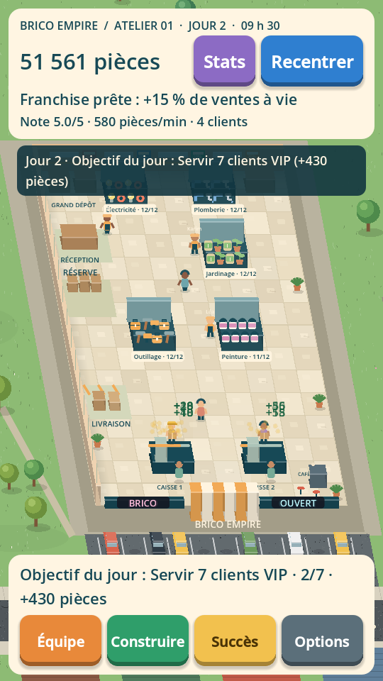

# Brico Empire

Première version jouable d’un jeu de gestion mobile en français. Les clients achètent seuls, les employés transportent les marchandises et l’argent arrive uniquement lors des passages en caisse.

**Moteur : Godot 4.6.3 stable, GDScript, rendu Compatibility.** Aucun module externe, serveur, compte, publicité ou achat intégré. Cible Android/iOS portrait ; développement et tests sur Linux.

## Jouer directement sur Safari

**[Ouvrir Brico Empire](https://brico-empire-jeu.vividmug7.chatgpt.site)**

Hébergement HTTPS actif. Le site est privé : se connecter avec le compte ChatGPT propriétaire si demandé. Premier chargement : environ 10 Mo. Safari 16.4+ avec WebGL 2 est requis ; l’export a été testé sous Chromium, pas encore sur un iPad réel. La sauvegarde reste dans les données du navigateur.

## Jouer dans un navigateur (export fourni)

Le dossier **[web](web/)** contient une version réellement exportée du même jeu, avec son moteur WebAssembly officiel compressé. Aucun Godot à installer pour jouer dans le navigateur.

1. Télécharger **tout le dépôt** avec Code → Download ZIP, puis décompresser.
2. Installer Python 3 si nécessaire, ouvrir un terminal dans ce dossier et lancer :

```sh
python3 tools/serve_web.py
# Sur Windows, si la commande python3 n’existe pas :
py tools/serve_web.py
```

3. Ouvrir **http://localhost:8000** dans Chrome/Edge récent ou Safari 16.4+. Ne pas ouvrir `index.html` en double-cliquant : le moteur a besoin d’un serveur HTTP.

Premier téléchargement : environ **10 Mo** de moteur et de données. Le serveur Python est destiné au test local. Pour jouer sur iPad depuis un lien, héberger le dossier `web/` en **HTTPS** ; le jeu exige un contexte sécurisé. Une adresse HTTP du PC sur le réseau local ne suffit pas. Aucun lien de mise en ligne n’est annoncé sans déploiement confirmé.

La sauvegarde web reste dans le navigateur (IndexedDB), sur cette origine. Elle est distincte de la sauvegarde PC et peut disparaître si les données du site sont effacées ou en navigation privée.

## Jouer sur ordinateur

1. Télécharger [Godot 4.6.3 standard](https://godotengine.org/download/archive/4.6.3-stable/) (pas besoin de .NET).
2. Sur GitHub : **Code → Download ZIP**, puis décompresser tout le dossier.
3. Ouvrir Godot, choisir **Importer**, sélectionner `project.godot`.
4. Appuyer sur **F6** avec `main.tscn` ouverte, ou **F5** pour lancer le projet.

En ligne de commande, depuis le dossier du projet :

```sh
godot --editor --path .
godot --path .
```

Le premier démarrage importe les ressources. Si vous utilisez directement la ligne de commande après téléchargement :

```sh
godot --headless --editor --path . --import --quit
godot --path .
```

**Sur iPad : le ZIP GitHub ne s’installe pas comme une application.** Un export iOS depuis un Mac avec Xcode et une signature Apple est nécessaire. Aucun IPA ou APK n’est annoncé comme produit ici. Voir [les instructions d’export](docs/EXPORT.md).

## Commandes et objectif

- Toucher / cliquer sur un rayon, une caisse, un employé, la réserve ou une aile fermée pour ouvrir son panneau.
- Glisser pour déplacer la vue. Pincer à deux doigts, ou utiliser la molette sur ordinateur, pour zoomer. **Recentrer** adapte la vue à la surface ouverte.
- Fermer le panneau pour retrouver la vue complète. Les panneaux ne laissent pas passer les gestes vers le magasin.
- **Équipe** : recrutements et améliorations collectives. **Construire** : nouvelles familles, caisse et agrandissements.
- Commencer par observer une vente, puis améliorer l’outillage. Les étapes du tutoriel sont sauvegardées et le bouton **Passer** permet de le terminer immédiatement.

La version navigateur utilise le même code GDScript et la même simulation ; les fichiers JavaScript de `web/` sont le lanceur du moteur, pas une réécriture du jeu.

Le premier magasin contient l’outillage. Ouvrez la peinture, recrutez, ouvrez une nouvelle aile puis le jardinage. La seconde caisse comprend son caissier. Le grand dépôt double les réserves et ajoute 4 places à chaque rayon.

Les rayons indiquent leur stock et signalent les ruptures. Le panneau réserve montre les capacités par famille et la prochaine livraison. Le conseil contextuel s’appuie sur les 20 dernières secondes d’activité. Le revenu par minute est mesuré sur les encaissements récents, jamais un rendement théorique.

## Contenu de cette version

- Trois familles originales : outillage, peinture, jardinage ; deux agrandissements visibles du même magasin.
- Chaîne effective : livraison gratuite → réserve dédiée par famille → employé avec carton → rayon → produit pris → file de caisse → paiement.
- Machines à états distinctes pour clients et employés, tâches réservées, deux points d’achat par rayon, files ordonnées et limite de 20 clients.
- Améliorations de capacité, valeur et service des rayons ; déplacement, transport et réassort de l’équipe ; encaissement. Cinq niveaux maximum.
- Changements de mobilier aux niveaux 3 et 5 de capacité/valeur ; changement de caisse à partir du niveau 3.
- Sauvegarde locale atomique avec secours, tutoriel, réglages son/effets réduits et progression hors ligne prudente.
- Graphismes vectoriels originaux et sons synthétisés. Aucune musique dans cette version.



## Structure

```text
data/balance.json          Toutes les valeurs économiques et les définitions des rayons
src/core/                  Chargement des données et sauvegarde versionnée
src/sim/inventory.gd        Stocks et transferts synchrones
src/sim/navigation.gd       Grille A* et déplacement par chemins pré-calculés
src/sim/customer.gd         Machine à états des clients
src/sim/worker.gd           Machine à états des employés
src/sim/progression.gd      Conditions, prix, achats et objectifs
src/sim/simulation.gd       Orchestration à pas fixe, encaissements, observations
src/view/store_view.gd      Dessin original, animations, caméra et gestes
src/ui/game_ui.gd           HUD et feuilles contextuelles
src/audio/game_audio.gd     Sons synthétisés
src/main.gd                Cycle de vie, sauvegarde, pause/reprise
assets/                    Icône originale
tests/                     Économie, stocks, sauvegarde, interface et équilibrage
docs/                      Captures, résultats et limites
```

Le contenu utilise des identifiants stables (`atelier_01`, `tools`, `paint`, `garden`). Un autre magasin pourra apporter ses définitions et son plan. Il n’y a pas de carte ni de système de magasins multiples prématuré.

## Tests

Après l’import Godot :

```sh
godot --headless --path . --script tests/test_suite.gd
godot --headless --path . --script tests/balance_sim.gd
# Nécessite une session graphique, produit des captures dans docs/ :
godot --path . --script tests/ui_smoke.gd -- --smoke
```

Les tests utilisent des sauvegardes distinctes de la partie. `ui_smoke.gd` réinitialise uniquement sa sauvegarde `smoke_save.json`.

Consulter [le bilan des vérifications](docs/VERIFICATION.md), [les données brutes d’équilibrage](docs/balance-results.json) et [l’état de reprise](docs/STATUS.md).

## Mode développeur

Désactivé par défaut : lancer avec `godot --path . -- --dev`, puis ouvrir **Réglages**. Commandes : vitesse ×1/×4/×16, argent de test, états des agents, prochaine étape et inspection des tâches/stocks. Ces commandes ne sont pas affichées en mode normal. Les ajouts d’argent modifient la partie locale : utiliser une sauvegarde de test si nécessaire.

## Sauvegarde et absence

Fichiers : `user://brico_save.json`, `.bak` et fichier temporaire `.tmp`. Godot place `user://` dans son dossier de données utilisateur :

- Windows : `%APPDATA%/Godot/app_userdata/Brico Empire/`
- Linux : `~/.local/share/godot/app_userdata/Brico Empire/`
- macOS : `~/Library/Application Support/Godot/app_userdata/Brico Empire/`
- Mobile : stockage privé de l’application.

Sauvegarde après achat, encaissement, progression du tutoriel, réglage, toutes les 15 secondes et à la perte de focus/pause. Les positions des agents ne sont pas conservées. Au chargement, les produits en transport et dans les paniers non encaissés retournent à leur réserve familiale ; les marchandises déjà vendues n’y retournent pas. Une réserve peut donc dépasser temporairement sa capacité ; les livraisons attendent alors qu’elle redescende. Ce retour ne crée ni vente ni revenu.

Hors ligne : seulement après au moins 60 secondes observées et 5 ventes récentes ; 40 % du rythme encaissé sur une fenêtre de 120 secondes au maximum, absence minimale de 60 secondes et plafond récompensé de 2 heures. Durées négatives ou supérieures à 366 jours rejetées. Le résultat est une **estimation**, enregistrée avant son affichage pour éviter un second crédit au rechargement. La simulation s’arrête en arrière-plan. La modification de l’horloge n’est pas entièrement empêchée dans ce jeu local.

Une sauvegarde v1 est migrée vers v2 sans inventer d’historique hors ligne. Fichier principal corrompu : tentative de secours ; deux fichiers illisibles : nouvelle partie accompagnée d’un message.

## Licence et état

Code et créations originales du projet sous licence MIT : [LICENSE](LICENSE). Provenances et licences : [ASSETS.md](ASSETS.md).

Prototype jouable, **pas prêt à publier**. Les tests sur appareils Android/iOS, les encoches réelles, les performances et les exports signés restent à valider. Aucun résultat de fluidité mobile n’est déduit des tests Linux. Le navigateur Chromium a aussi exécuté le véritable export WebAssembly ; Safari sur iPad reste à vérifier.


Tests navigateur optionnels : `tests/test_web.py` requiert Python, Playwright/Chromium et Tesseract pour lire les captures. Ces outils ne sont pas requis pour jouer ou pour lancer le serveur web local. Exécuter le test avec `python3 tests/test_web.py` après démarrage de `tools/serve_web.py`.
